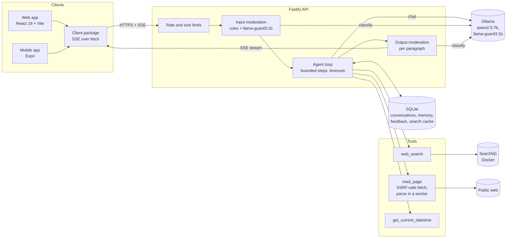

# local-ai-assistant

A general-purpose AI assistant that runs entirely on my Mac and costs nothing to run. It answers from the model's own knowledge, or searches the web when a question needs current information, and cites what it found with numbered links. It sits behind layered guardrails that I measure with a red-team eval.

It is a demo project, separate from my retrieval-only portfolio chatbot.

## Honest expectations

- A 7B model running locally is far less capable than ChatGPT or Gemini. Expect weaker reasoning, more mistakes and shorter useful answers.
- Search makes it current, but the quality of an answer depends on the model and on what the search returns.
- Every eval number in this repository is reported exactly as measured, with the date and the command.

## Status

| Milestone | Scope                                               | State       |
| --------- | --------------------------------------------------- | ----------- |
| 0         | Repository, tooling, CI, docs skeleton              | Done        |
| 1         | Architecture debate and ADRs                        | Done        |
| 2         | Chat with Ollama, streaming API, minimal web client | Done        |
| 3         | Guardrails and the red-team eval in CI              | Done        |
| 4         | Web search with SearXNG, SSRF protection, citations | Done        |
| 5         | Memory, feedback and safe learning                  | Done        |
| 6         | Polished web client and Expo mobile app             | In progress |
| 7         | Production write-up and final audit                 | Planned     |

## Architecture

This is the design I settled on in the [architecture decision records](docs/adr/README.md); [docs/architecture](docs/architecture/README.md) walks through a turn end to end.



## Quick start

You need Node.js 24 and Ollama with `qwen2.5:7b` and `llama-guard3:1b` pulled ([local setup](docs/local-setup.md)).

```bash
git clone https://github.com/AnkurSingh16/local-ai-assistant.git
```

```bash
cd local-ai-assistant && npm ci
```

```bash
npm run dev
```

Then open http://127.0.0.1:5173. It answers from model knowledge, and searches the web through SearXNG for anything time-sensitive, citing sources with numbered links. Every message is checked by input rules (self-harm, slurs, abuse, sexual content involving minors, injection, personal data) and `llama-guard3` before the model sees it, and every paragraph of the answer is checked by persona rules and `llama-guard3` before it is sent; the red-team results are in the [safety guide](docs/guides/safety.md#measured-results).

## Documentation

- [Requirements](docs/architecture/requirements.md) and [architecture](docs/architecture/README.md)
- [Architecture decision records](docs/adr/README.md)
- [Local setup](docs/local-setup.md)
- [Safety guide](docs/guides/safety.md)
- [Development](docs/development/README.md)
- [Configuration](docs/reference/configuration.md) and [API](docs/reference/api.md) reference
- [Taking it to production](docs/production.md)

## License

[MIT](LICENSE)
