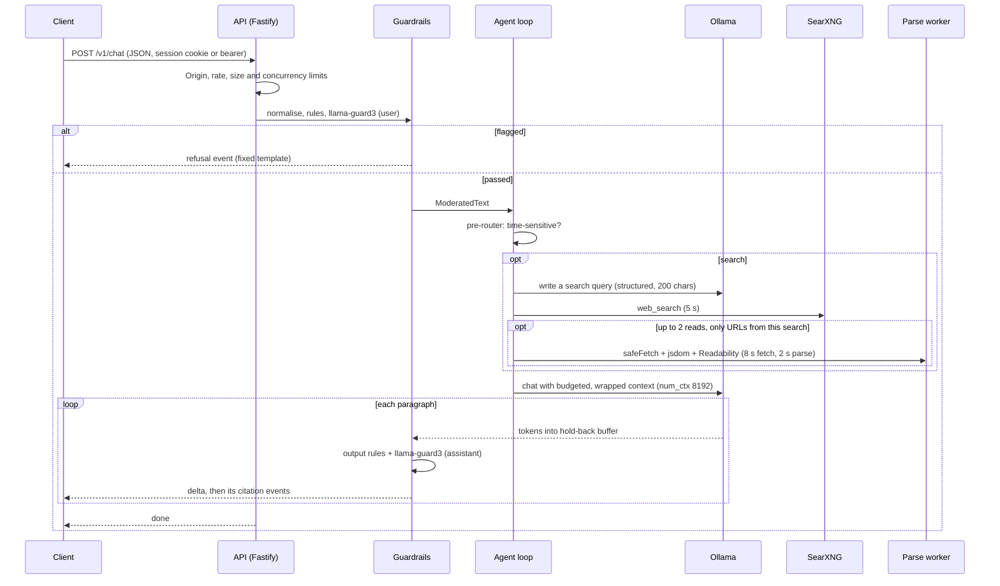

# Architecture

The README has the system diagram. This page explains how a turn flows through the system and where each decision is recorded. The decisions themselves are in [`docs/adr/`](../adr/README.md).

| Document                           | Contents                                   |
| ---------------------------------- | ------------------------------------------ |
| [requirements.md](requirements.md) | What the system must do, and fixed choices |

## Packages

| Package      | Responsibility                                                              | ADR                                                                                            |
| ------------ | --------------------------------------------------------------------------- | ---------------------------------------------------------------------------------------------- |
| `core`       | Domain types, provider interfaces, `Clock`, `ModeratedText`                 | [0002](../adr/0002-packages-interfaces-boundaries.md)                                          |
| `contract`   | Zod schemas for requests and SSE events                                     | [0007](../adr/0007-streaming-contract.md)                                                      |
| `agent`      | Agent loop, routing, taint rule, context budget, persona                    | [0003](../adr/0003-agent-loop-and-tools.md), [0004](../adr/0004-context-budget-and-history.md) |
| `guardrails` | Normalisation, rules, moderation pipeline, hold-back buffer, refusals       | [0005](../adr/0005-guardrail-pipeline.md), [0006](../adr/0006-guard-model-size.md)             |
| `tools`      | `web_search`, `read_page`, `get_current_datetime`, safe fetch, parse worker | [0008](../adr/0008-fetch-safety.md)                                                            |
| `providers`  | Ollama and SearXNG adapters, mock providers                                 | [0002](../adr/0002-packages-interfaces-boundaries.md)                                          |
| `storage`    | SQLite repositories, migrations, deletion                                   | [0001](../adr/0001-storage-sqlite.md), [0009](../adr/0009-sessions-and-memory-deletion.md)     |
| `client`     | Headless SSE client for web and mobile                                      | [0007](../adr/0007-streaming-contract.md)                                                      |
| `eval`       | Red-team and routing sets, recorded fixtures, runner                        | [0012](../adr/0012-evaluation-in-ci.md)                                                        |

## A turn, end to end

Only text that passed moderation is stored. Raw search results and page text never enter history.

## Trust boundaries

1. **Client to API.** Untrusted input. Limits, CSRF checks and input moderation apply before anything else ([0005](../adr/0005-guardrail-pipeline.md), [0007](../adr/0007-streaming-contract.md), [0011](../adr/0011-search-cache-and-rate-limits.md)).
2. **API to chat model.** The model's output is untrusted until each paragraph passes output moderation.
3. **Web content to model.** Search snippets and pages are wrapped as data with a nonce, and the taint rule limits what the model may do after seeing them ([0003](../adr/0003-agent-loop-and-tools.md), [0008](../adr/0008-fetch-safety.md)).
4. **API to network.** Only `safeFetch` reaches the public web, and it refuses private addresses on every hop ([0008](../adr/0008-fetch-safety.md)).
5. **API to storage.** Only `ModeratedText` crosses, and deletion is real ([0001](../adr/0001-storage-sqlite.md), [0009](../adr/0009-sessions-and-memory-deletion.md)).

Everything listens on loopback unless I opt in ([0010](../adr/0010-process-topology-and-pinning.md)).
